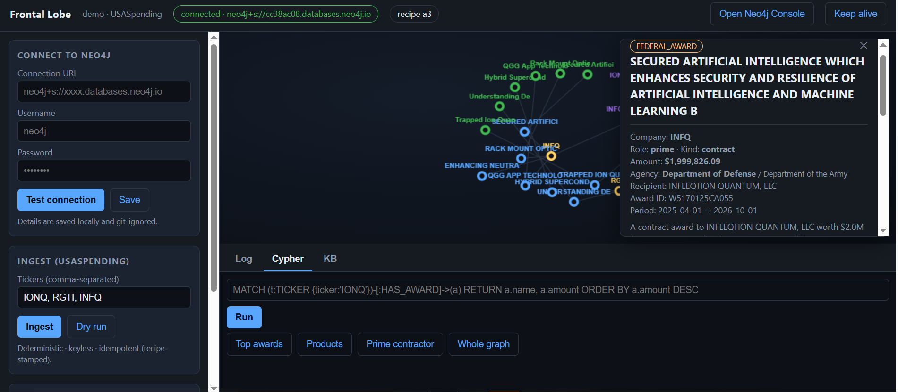

# Frontal Lobe - demo (who the U.S. government pays, as a knowledge graph)



> **This is a DEMO LEG** of the full **Frontal Lobe** app - a GraphRAG system
> that reads the real paperwork (SEC contracts, USPTO patents, and federal
> awards from USASpending.gov) behind hard-tech companies and turns it into a
> navigable knowledge graph.
>
> The **full Frontal Lobe** app is **private at this time**. See it in action:
> **https://youtube.com/shorts/1lC-xFJX5AM** (or [Request the full demo](#request-the-full-demo) for a live walkthrough / source under NDA).
>
> This public repo ships **one complete "evidence leg"** - federal awards from
> USASpending.gov - folded into a small Neo4j knowledge graph, with a local
> control panel that includes a simple 2D graph map.

---

## What's in this repo

```
frontal-lobe-demo/
├── api/
│   ├── app/              ← the FastAPI app + the USASpending leg
│   │   ├── server.py         (localhost:8765)
│   │   ├── usaspending.py    (fetch → rank → fold → build; deterministic)
│   │   ├── writer.py         (plain-Cypher Neo4j writer - no APOC)
│   │   ├── award_config.py   (the leg's only tuning file)
│   │   ├── schema.py         (the full graph vocabulary)
│   │   ├── mcp_server.py     (MCP host so an external agent can ingest/query)
│   │   └── db.py             (driver; connection saved per-user)
│   └── static/           ← the local control panel (2D graph, ingest, log)
├── runtime/              ← git-ignored: your connection.json + logs
├── sample_data/          ← real exported award JSONs (IONQ, RGTI)
├── queries/
│   └── cypher_examples.md
├── docs/screenshots/
├── requirements.txt
├── setup.ps1
├── README.md
└── LICENSE
```

Your Neo4j connection details are saved locally to `runtime/connection.json`,
git-ignored — they never leave your machine except to reach your own database.

## The USASpending leg

Deterministic, keyless, idempotent (recipe-stamped). For each ticker it:

1. **Resolves UEIs** — recipient search → SAM Unique Entity IDs (the join key).
2. **Fetches** prime awards (contracts + grants, 5-year window) and subawards
   (net-summed per Sub-Award ID).
3. **Ranks by dollars** (primes + subawards together) and takes the top 4 as
   `FEDERAL_AWARD` nodes, plus a `PRODUCT` per award (from the description) and
   the prime contractor as a `COMPANY` on subcontracts.
4. **Folds** everything onto the ticker's `TICKER` node (or a real `SUBSIDIARY`),
   with one `AWARD_INVENTORY` portfolio node for the rest.
5. **Writes** in a single transaction — re-running at the same recipe writes
   nothing.

Node types: `TICKER · FEDERAL_AWARD · PRODUCT · COMPANY · AWARD_INVENTORY ·
(rare) SUBSIDIARY`. Graph edges: `HAS_AWARD · HAS_AWARD_INVENTORY · COVERS ·
AWARDED_BY · SUBSIDIARY_OF`.

### What's *not* here (the full system adds)

- **SEC leg** — material contracts & clauses as `CONTRACT_TERM` hubs (action
  verbs like `GRANTS`, `BUYS`, `OWNS`).
- **USPTO leg** — patents, inventors, technology.
- **Marlowe** — a voice/text research agent that searches the graph and the web.
- **Semantic search** and an **MCP host over the full system**.

Those live in the private system; this demo keeps the roads clear so you can see
how one leg works end to end.

---

## Setup (Windows, ~10 minutes)

Runs on your own machine against **your own free Neo4j cloud database**. You
create the DB once, paste its details into the app once, and you're done.

### 1. Create your free Neo4j database (one time)
1. Go to **https://console.neo4j.io**, sign up (easiest with "Continue with Google").
2. **New Instance → Create Free instance** (AuraDB Free; no credit card).
3. **Save your credentials right away** — the **connection URI** (`neo4j+s://…databases.neo4j.io`),
   the **username** (`neo4j`), and the **generated password** (shown **once** — click **Download** to save the `.txt`).

### 2. Install and start
In PowerShell, in the folder where you cloned the repo:
```powershell
powershell -ExecutionPolicy Bypass -File .\setup.ps1
```
It creates a virtual environment, installs requirements, starts the app, and
opens **http://localhost:8765**. Requires Python 3.11+.

### 3. Connect once
In the app's **Connect to Neo4j** box, enter the URI / username / password, click
**Test connection**, then **Save**. If the test fails, the app tells you why
(wrong password, paused instance, unreachable, or bad URI).

### 4. Ingest and explore
Enter tickers (try `IONQ RGTI`) and click **Ingest**. The live log shows each
step. Then:
- **Map** — the 2D force graph of the company → its awards → products. Click a
  node to see its full record.
- **Cypher** — run the starter queries (copy buttons) or your own.

### Free-tier notes (AuraDB Free)
- **200,000 nodes / 400,000 relationships.** This leg writes a few dozen per
  ticker. The app shows a usage meter.
- **It sleeps:** an idle Free instance pauses after **72 hours without a write**
  (reads don't count). Resume with the play button.
- **Don't leave it paused:** a Free instance paused more than **30 days is
  deleted** and unrecoverable. Use the app's **Keep-alive** button (a tiny write).

---

## Example queries (all read-only)

**Top federal awards for a company**
```cypher
MATCH (t:TICKER {ticker: 'IONQ'})-[:HAS_AWARD]->(a:FEDERAL_AWARD)
RETURN a.name, a.role, a.kind, a.amount, a.agency_toptier
ORDER BY a.amount DESC
```

**What products do the awards cover?**
```cypher
MATCH (t:TICKER)-[:HAS_AWARD]->(a:FEDERAL_AWARD)-[:COVERS]->(p:PRODUCT)
RETURN t.ticker, p.name, a.amount
ORDER BY a.amount DESC LIMIT 25
```

**Prime contractors a company works under (subcontracts)**
```cypher
MATCH (t:TICKER {ticker: 'INFQ'})-[:HAS_AWARD]->(a:FEDERAL_AWARD {role: 'subcontract'})
      -[:AWARDED_BY]->(prime:COMPANY)
RETURN prime.name, count(a) AS awards, sum(a.amount) AS total
ORDER BY total DESC
```

**Whole graph, without the internal chunks**
```cypher
MATCH (n) WHERE NOT n:Chunk AND NOT n:_Heartbeat
OPTIONAL MATCH (n)-[r]->(m) WHERE NOT m:Chunk AND NOT m:_Heartbeat
RETURN n, r, m
```

---

## Request the full demo

The full system is the worth-seeing one. I'm happy to:
- **Walk it through live** — ingest a company across all three legs and explore
  the graph.
- **Share the source under NDA** for a technical review.

Contact: **dev@w57th.agency**

---

## Built with

Python · FastAPI · Neo4j (AuraDB) · FastMCP · USASpending.gov (keyless) · a small
hand-rolled 2D force graph.

*Built 2026 as a portfolio project demonstrating enterprise GraphRAG on real
public filings. Data from public U.S. government sources.*

## License

All rights reserved. This repository is published for evaluation and
demonstration. You may read and run it locally; you may not redistribute it or
use it commercially without written permission.
